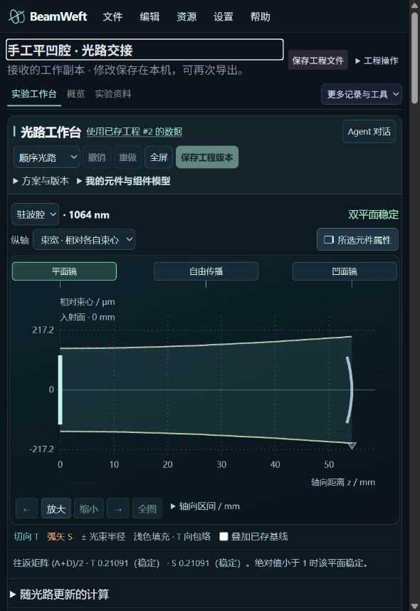
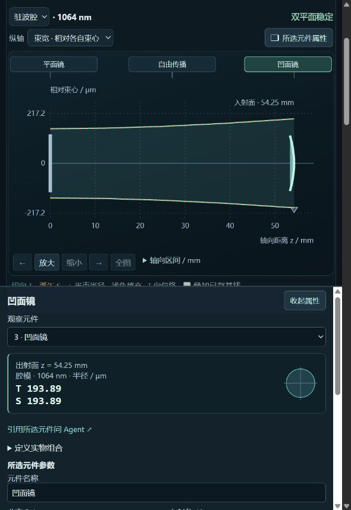
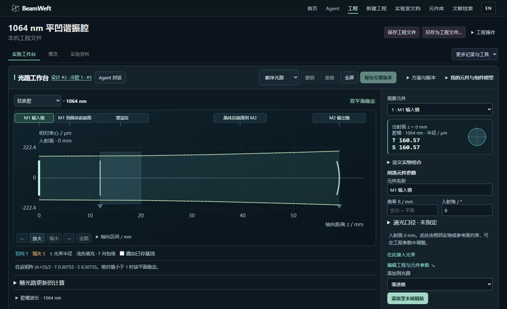

# BeamWeft 1.9

[English](README.md) · **简体中文**

原名 LaserClaw。已有的 `.lclaw` 工程文件可以直接打开。

**产品目标：通用的 Agentic 激光光学仿真软件。** 从实验人员的目标、器件、资料、测量与工作流程出发；常规换件、改布局、改参数和换目标通过工程数据与工具调用完成。能力不足时扩展独立物理模型与契约，不能用单个案例的隐藏假设代替通用能力。

在 **1.9.0** 中，Agent 保存的光路可以直接在工程画布上继续编辑。你可以手动改元件、看光束复算，也可以让 Agent 读取当前尚未保存的草稿。多个方案可分别打开，历史答复仍能定位到当时的光路。

**用任务驱动的 AI Agent 组织激光实验设计、仿真和数据分析。** 新建工程只需名称，可直接搭建光路或放入测量原件。实验目标、器件资料和约束都可以稍后补充。Agent 读取信息、选择工具、检查真实计算结果、保存工程，并在需要时给出有单位和获取方法的补测问题。

[下载 Windows 版](https://github.com/Hewei603/BeamWeft/releases/download/v1.9.0/BeamWeft-1.9.0-Windows.zip) · [使用指南](docs/GUIDE_V2.md) · [Codex exec 配置](docs/CODEX_EXEC.md) · [Agent 与物理工具边界](docs/WORKBENCH.md) · [1.9 更新说明](CHANGELOG.md)

| 画布上的 1064 nm 谐振腔 | 选中凹面镜查看参数 |
| --- | --- |
|  |  |

两张实拍截自同一个示例工程。点选凹面镜，既能读出镜面处的光斑半径，也能直接编辑这个元件。

## 当前能力

- **两种模型接入**：首页选择 API Key 或 Codex exec。Codex exec 使用后端电脑上官方 CLI 的 ChatGPT 登录与订阅额度，默认模型 `gpt-6.1-sol`；提供登录状态和真实连接测试。API Key 支持隐藏和显示，切换模式保留已保存配置。
- **按需调用工具的 Agent**：查询元件库、读取附件和历史结果，构造光学模型、扫描参数、比较场景、保存可编辑工程；缺数据时明确说明问题、获取方法和回复格式。
- **通用近轴光学工程**：单程、驻波腔及共面环形腔；T/S 两轴、平面介质、薄／厚透镜、GRIN、自定义 ABCD、实测焦散拟合和二维稳定图。已有元件的角色和参数可锁定，修改保存为新版本。
- **从保存的截面接着算**。可以在晶体内部取出带当地折射率、波前和指向的光束，也可以在孔径后把相干衍射场交给另一段单程光路。手工和 Agent 都能引用同一结果，并核对上下游参考面与采样条件。[工作台操作说明](docs/GUIDE_V2.md#从光路上的一个量继续计算)
- **可读的光场分析**：物理位置示意、晶体与掺杂段边界、半径／直径、单位切换、沿程曲线和截面高斯光斑，支持 CSV／SVG／PNG 导出；结果区可以展开全宽。
- **数据与结论保持一致**：计划和报告使用最新工程，保留旧版本、工具输入输出、失败记录和未完成项。库存刷新保留借还、人工状态和器件身份。

**模型范围。** 冷腔和高斯光束由 BeamWeft 的 Python/NumPy ABCD 内核计算，单程相干光场由基于傅里叶变换的标量菲涅耳传播方法计算。Rezonator 用作冷腔计算的外部对照。判断实际起振、输出功率或效率最优，还需要相应的增益、损耗和实验数据。增益饱和、空间热场和无膜端面形成的复合腔各自需要进一步建模和验证。验收案例中的 26 mm 腔长是在给定条件下得到的参考布局。


此前的开发验收用独立矩阵算法复核了两种晶体朝向下的 3,538 个稳定性扫描点，详见[历史验收报告](docs/releases/2.0.0/validation/review.html)。1.9 的回归测试也覆盖了[手工与 Agent 在画布上的交接](backend/tests/test_agent_canvas_outputs.py)。

BeamWeft 是一款可在本地使用的光学实验工作台。你可以亲手搭建光路、运行物理计算、用测量数据检验预测，也可以把同一份工程交给 Agent 继续分析。

在单程光路里，展开 **主光束参数** 即可登记光源。椭圆或像散光束可以分开填写切向 T 和弧矢 S 的半径、波前及 M²。若只测了某一方向的源面半径，保留“波前尚未确定”即可。工作台会显示该面已知的宽度，并继续计算另一方向。选中观察面可查看当地束心与光斑半径。[光路操作说明](docs/WORKBENCH.md#following-a-beam-from-its-source)

> 安全说明：BeamWeft 不控制激光器、电源、位移台、联锁、光学平台、探测器或任何实验室硬件。AI 生成内容只作为辅助草稿，必须由具备资质的人员复核后才能用于真实实验。



[桌面首页实景](docs/images/beamweft-home.webp) · [窄屏首页实景](docs/images/beamweft-home-mobile.webp)

## 解决什么问题

| 问题 | BeamWeft 的做法 |
|---|---|
| 实验知识分散在手册、SOP、笔记和附件里 | 使用两层 RAG 同时检索全局实验室文档和 Case 专属文档 |
| AI 回答难以审计 | 保存 retrieval run、citation、generated artifact、Agent step 和 tool call |
| 排障、计划、报告重复劳动多 | 自动生成结构化 plan、troubleshooting、report,几何参数由确定性物理内核计算 |
| 课题组需要长期协作 | 支持项目、用户、组、权限、知识库治理、prompt/workflow 版本和 Case bundle |

## 核心能力

- **Case-aware Agent chat**：持久化聊天会话，带上绑定 Case、最近对话、RAG 结果、citation 和检索置信度。
- **两层 RAG**：全局实验室知识作为共享依据，Case 附件和生成内容作为当前实验上下文。
- **全局知识库**：支持上传 PDF、TXT、Markdown、CSV、JSON、TSV、log 等共享文档。
- **知识库治理**：支持 source status、version、owner、reviewer、review time 和 reindex。
- **Tool-calling Agent 工作流**：自动路由普通聊天、实验计划、故障排查、实验报告和物理计算模块(谐振腔设计、相位匹配、镀膜评估、元件匹配、功率曲线)。
- **确定性物理内核**(纯 numpy):ABCD/高斯光束腔分析与**腔型设计搜索**(按实测热透镜裕度排序)、薄膜 TMM 镀膜评估、单轴/双轴相位匹配、功率曲线阈值与斜率效率拟合(含 Findlay-Clay / Caird 腔损耗反推)。实验计划里的几何与角度**是算出来的**,不是模型编的。
- **结构化元件库**:导入实验室元件清单(.xlsx),把镀膜/曲率/口径解析成结构化数据,按波长×功能做数据库级筛选,并针对需求逐参数判定(可用 / 需实测 / 淘汰,含非支配前沿)。腔型设计搜索只会推荐库里真有的镜子。
- **借还与损坏台账**:借出只减**可用量**、不动工作簿里的库存数(否则下次重新导入会静默清账);人工标注的损坏与解析出的状态分开存,重新导入冲不掉;借出去的、标损坏的元件不会进匹配结果,并给出显式淘汰理由。
- **文献检索**(三个入口:独立页面 / 案例模块 / Agent 对话):确定性检索免费免注册的 OpenAlex + arXiv,按 DOI/标题去重,状态诚实(查不到就明说,不静默返回空),支持 BibTeX 导出。结果为元数据与摘要——系统不读全文并明确声明;存档进案例的检索结果会成为计划/报告可引用的知识。
- **可打印方案**:腔设计结果带一张横向真实比例的**摆位图**(镜面朝向、晶体位置、冷腔基模包络与束腰),整页 `Ctrl+P` 即可存成 PDF 带进实验室——矢量图,白底黑字,导航与按钮自动隐藏。
- **结构化 AI artifact**：保存 plan、troubleshooting、report、image analysis、物理模块结果等生成内容。
- **Prompt/workflow 版本管理**：维护 active prompt 和 workflow version，支持可复现 AI 运行。
- **工程交接**。保存为 `.lclaw`，在另一套 BeamWeft 中打开原件和历史光路，复核计算后继续编辑并写回工程文件。[打开工程文件](docs/GUIDE_V2.md#在另一台电脑上复核案例)
- **项目级 ACL**：Case、知识检索、附件、生成、Agent task、Case module 和 bundle export 都遵循项目权限。
- **RAG eval 与 benchmark**：提供脚本和 API，评估检索准确率、延迟、索引吞吐和 LLM JSON 可靠性。
- **检索后端**：支持确定性的 `sql_json`、Chroma、pgvector，以及可选 cross-encoder reranking。
- **Provider 支持**：MockProvider、OpenAI-compatible Chat Completions(OpenAI、DeepSeek、通义千问/DashScope、智谱 GLM、Moonshot Kimi)、Anthropic。
- **双语 UI**：支持中英文界面切换。

## 技术架构

```text
React + Vite 前端
  -> FastAPI 后端
      -> Case / attachment / knowledge / generation / agent / collaboration APIs
      -> SQLAlchemy models 和 Alembic migrations
      -> 本地 SQLite 或 Docker PostgreSQL/pgvector
      -> 文件上传和全局知识文档
      -> RAG 文档解析、切块、embedding、检索、citation
      -> 确定性物理内核(ABCD/高斯腔、薄膜 TMM、相位匹配、功率曲线拟合)—— 纯 numpy,不经过 LLM
      -> 结构化元件库(清单解析 + 逐参数评估器)
      -> OpenAI 兼容 / Anthropic / Mock provider
      -> 审计日志、usage、Agent trace、generated artifact
```

## RAG 工作流

```text
全局文档 / Case 附件 / 生成内容
  -> 文本抽取
  -> chunk 切分
  -> embedding
  -> KnowledgeSource + KnowledgeChunk
  -> 查询时检索
  -> RetrievalRun + RetrievalResult
  -> 带 citation 的上下文
  -> chat 或 artifact generation
```

BeamWeft 有两类检索来源：

1. **全局实验室知识**：安全手册、SOP、光学元件目录和实验室规则。所有 Case 都可以检索这类文档。
2. **Case 专属知识**：Case 数据、附件、图像分析、历史报告和生成内容，用于补充当前实验上下文。

[查看 LaserClaw 早期版本的知识检索界面](https://github.com/user-attachments/assets/ffc09e0d-93a4-4259-a07b-c943fbbf4cf9)

## Agent 工作流

```text
用户消息
  -> 创建或找到 chat session
  -> 保存 user message
  -> 判断意图
  -> 根据聊天历史、Case 数据、RAG 结果和 citations 构造上下文
  -> 返回聊天回复或创建正式 Agent task
  -> 保存 assistant message / task / artifact / citations
```

普通聊天时，后端会把结构化上下文交给模型回答。生成 artifact 时，系统会创建 `AgentTask`，生成步骤，调用工具，检索证据，生成内容，保存到 Case，并保留完整执行轨迹。

## 检索选项

默认 RAG 栈是确定性的本地实现：

- tokenization：ASCII 词项，加中文字符、bigram、trigram
- 常见安全和光学术语的 synonym expansion
- 按 `[SAF-PPE]`、`[SAF-SOP]`、`[OPT-MIRROR]` 等标题做 section-aware chunking
- chunk 上保存 section metadata
- 对安全和光学相关查询做轻量 domain boost

生产取向的检索后端也已经接入：

- `sql_json`：基于 JSON embedding 和词法评分的本地 fallback
- `chroma`：带本地持久化 collection 的 dense vector retrieval
- `pgvector`：PostgreSQL/pgvector 检索，SQL metadata 仍然是权威来源
- 可选 `sentence_transformers` cross-encoder reranker，只对有限候选集重排

操作和验收细节见 [docs/RAG_OPERATIONS.md](docs/RAG_OPERATIONS.md)。

## 当前评测证据

下面每个数字都可以用旁边的命令在本仓库复现,配置为**默认本地配置**
(`EMBEDDING_PROVIDER=local`、`RETRIEVAL_BACKEND=sql_json`、`AI_PROVIDER=mock`)。
测量时间 2026-07-26。每条命令都会把 JSON 报告写到 `docs/benchmarks/`,该目录**已 gitignore**
——因为报告可能索引到私有实验室文档,所以请在本地自行重跑生成,而不是依赖仓库里的副本。

检索语料是**合成的**(不是真实实验室制度、设备数据或安全培训材料),而且规模很小
(3 个文档源、5 个分块、10 条带标注的查询)。因此这些检索数字只说明**流程是通的**,
**不是**对生产规模准确率的声明。

| 检查项 | 结果 | 复现命令 |
|---|---|---|
| 后端测试套件 | 386 passed, 2 skipped | `cd backend && py -m pytest -q` |
| 物理内核对拍(解析解/文献值) | 已含在上面(TMM 与独立的 `tmm` 库对拍至机器精度) | `py -m pytest tests/test_physics_*.py -q` |
| 意图路由用例 | 57 passed | `py -m pytest tests/test_router.py -q` |
| RAG 数据集断言 | 8 passed(37 条查询数据集) | `py -m pytest tests/eval_rag_dataset.py -q` |
| Agent 轨迹完整性 | 7 passed | `py -m pytest tests/eval_agent_trace.py -q` |
| API 鉴权依赖审计 | 80 条 `/api/*` 路由,0 findings | `py scripts/audit_endpoint_acl.py` |
| 前端 lint/build | 通过 | `cd frontend && npm run lint && npm run build` |

合成语料上的检索质量与延迟
(报告:`docs/benchmarks/resume_metrics_*.json`):

| 指标 | 结果 |
|---|---:|
| Recall@1 | 90.00% |
| Recall@3 | 100.00% |
| Recall@5 | 100.00% |
| MRR | 0.95 |
| 查询延迟 p50 / p95 | 12.7 ms / 14.4 ms |
| 索引吞吐 | 103.9 块/秒 |

复现:`py scripts/benchmark_resume_metrics.py --repeats 3 --skip-llm`
(10 条标注查询 × 3 轮 = 30 次查询,top_k=5)。

结构化生成的输出形状与延迟(MockProvider,
`docs/benchmarks/latest_generation_latency.json`):

| 模式 | 次数 | Schema 通过率 | p50 延迟 |
|---|---:|---:|---:|
| plan | 3 | 100% | 658 ms |
| troubleshooting | 3 | 100% | 47 ms |
| report | 3 | 100% | 46 ms |

复现:`py scripts/benchmark_generation_latency.py --repeats 3`。
这里的延迟是确定性模板路径;接真实模型后延迟由模型主导
(用 `gpt-5` 生成一份实验计划约需 60–120 秒)。

其他 benchmark 脚本:

- `backend/scripts/benchmark_retrieval_backends.py`:配好 pgvector 数据库后,对比 `sql_json`、Chroma、pgvector。
- `backend/scripts/eval_authorized_rag.py`:在授权的私有语料上评测检索。

已知限制:

- 公开语料是合成的且规模很小;引用任何检索数字前请在你自己的语料上重测。
- 本地词法检索不能替代生产级 embedding 或 reranking。
- 上面的生成 benchmark 用的是 MockProvider,衡量的是 schema 形状与链路,不是模型质量。
- 物理结果是确定性的且有单元测试,但**纸面上稳定的腔不等于一定能出光**:泵浦模式重叠、镀膜损耗、对准质量仍然决定成败。

## Windows 快速启动

安装 [Python 3.11 或更高版本](https://www.python.org/downloads/)，勾选「Add python.exe to PATH」。将 Windows ZIP 完整解压到有写入权限的文件夹，再双击下面的启动器。ZIP 已包含构建好的界面。从 Git 仓库运行源码时，还需要安装 [Node.js 22.12 或更高版本](https://nodejs.org/) 来构建界面。

```bat
Launch-BeamWeft.bat
```

首次启动会安装 Python 依赖并打开本机工程库。你可以先手工搭光路、运行仿真，随后按需配置 Agent。[Windows 使用说明](docs/WINDOWS_TRIAL.md)

如果工作台已经打开，再次双击会连接到现有服务。安装或更新后首次打开会构建生产版界面，之后可复用本地构建。若端口由旧版本占用，请先保存工作并结束正在运行的任务，再关闭旧窗口。

启动器提供以下本机入口。

- 后端 API：<http://127.0.0.1:8000>
- 前端：<http://127.0.0.1:5173>
- Agent 工作台：<http://127.0.0.1:5173/agent>
- API 文档：<http://127.0.0.1:8000/docs>

## 手动本地启动

后端：

```powershell
cd backend
py -m pip install -r requirements.txt
py -m alembic upgrade head
py -m uvicorn app.main:app --host 127.0.0.1 --port 8000
```

前端：

```powershell
cd frontend
npm install
npm run dev -- --host 127.0.0.1 --port 5173
```

## Docker

默认 Compose 文件面向生产形态：后端不使用 reload，前端构建为静态文件并由 nginx 服务。

```bash
docker compose up -d --build
```

服务地址：

- 前端：<http://localhost:5173>
- 后端 API：<http://localhost:8000>
- API 文档：<http://localhost:8000/docs>

如果需要带热更新的开发模式：

```bash
docker compose -f docker-compose.dev.yml up -d --build
```

停止：

```bash
docker compose down
docker compose -f docker-compose.dev.yml down
```

部署和 release gate 细节见 [docs/DEPLOYMENT.md](docs/DEPLOYMENT.md)，当前验收矩阵见 [docs/ACCEPTANCE.md](docs/ACCEPTANCE.md)。

## 环境变量

创建 `.env` 配置本地 provider 和运行参数。不要提交真实 API key。

```env
AI_PROVIDER=mock
STRICT_PROVIDER=false

OPENAI_API_KEY=
OPENAI_MODEL=gpt-5
OPENAI_BASE_URL=https://api.openai.com/v1

ANTHROPIC_API_KEY=
ANTHROPIC_MODEL=claude-sonnet-4-5

# 国内模型厂商(推荐):AI_PROVIDER 填厂商名 + 对应 key
DEEPSEEK_API_KEY=
DEEPSEEK_MODEL=deepseek-chat
QWEN_API_KEY=
QWEN_MODEL=qwen-plus
ZHIPU_API_KEY=
ZHIPU_MODEL=glm-4-plus
MOONSHOT_API_KEY=
MOONSHOT_MODEL=moonshot-v1-8k

DATABASE_URL=sqlite:///./laserclaw.db
UPLOAD_DIR=./uploads
MAX_UPLOAD_SIZE=52428800
AUTO_CREATE_TABLES=true

EMBEDDING_PROVIDER=local
RETRIEVAL_BACKEND=sql_json
VECTOR_STORE_DIR=./vector_store
DOCKER_VECTOR_STORE_DIR=/app/vector_store
PGVECTOR_DIMENSION=384
RERANKER_PROVIDER=none

REQUIRE_AUTH=false
API_KEY=

VITE_API_URL=http://127.0.0.1:8000
```

Provider 模式：

- `mock`：确定性的本地 demo 模式(输出为固定模板,页面顶部会显示演示模式横幅)
- `deepseek` / `qwen` / `zhipu` / `moonshot`：国内模型厂商(DeepSeek、通义千问、智谱 GLM、Kimi),填对应 `*_API_KEY` 即可
- `openai`：OpenAI-compatible Chat Completions provider
- `anthropic`：Anthropic provider

严格评测时建议设置 `STRICT_PROVIDER=true`，这样真实 Provider 不可用时会明确失败，而不是回退到 MockProvider。

## 质量检查

后端测试：

```powershell
cd backend
py -m pytest tests -q
```

后端 lint：

```powershell
py -m pip install -r backend\requirements-dev.txt
py -m ruff check backend
```

前端 lint 和构建：

```powershell
cd frontend
npm ci
npm run lint
npm run build
```

本地一键验收：

```powershell
cd backend
py scripts\acceptance_check.py
```

Hosted CI 和私有 eval 证据可用后，运行最终 release audit：

```powershell
cd backend
py scripts\final_acceptance_audit.py
```

## Benchmark

运行可复现 benchmark：

```powershell
py backend\scripts\benchmark_resume_metrics.py --repeats 10 --top-k 5
```

跳过真实 LLM 调用：

```powershell
py backend\scripts\benchmark_resume_metrics.py --repeats 10 --top-k 5 --skip-llm
```

授权私有文档 eval 使用 `docs/evals/private/` 下的 JSONL 文件，该目录默认不提交到 Git：

```powershell
cd backend
py scripts\index_authorized_docs.py
py scripts\eval_authorized_rag.py --dataset ..\docs\evals\private\rag_eval_authorized_holdout.jsonl --top-k 5 --min-positive-hit-rate 0.85 --min-negative-rejection-rate 0.90
py scripts\tune_retrieval_thresholds.py --dataset ..\docs\evals\private\rag_eval_authorized.jsonl --top-k 5
```

## 主要 API

- `POST /api/cases`
- `GET /api/cases`
- `GET /api/cases/{case_id}`
- `GET /api/cases/{case_id}/bundle`
- `POST /api/cases/{case_id}/attachments`
- `POST /api/cases/{case_id}/generate-plan`
- `POST /api/cases/{case_id}/generate-troubleshooting`
- `POST /api/cases/{case_id}/generate-report`
- `POST /api/knowledge/sources/upload`
- `GET /api/knowledge/sources`
- `PATCH /api/knowledge/sources/{source_id}/governance`
- `POST /api/knowledge/search`
- `POST /api/agent/chat`
- `POST /api/agent/tasks`
- `GET /api/agent/tasks/{task_id}`
- `POST /api/collaboration/users`
- `POST /api/collaboration/groups`
- `POST /api/collaboration/projects`
- `POST /api/versioning/prompts`
- `POST /api/versioning/workflows`
- `POST /api/evals/rag`
- `POST /api/evals/rag/private-dataset`
- `POST /api/cases/{case_id}/modules`
- `POST /api/cases/modules/{module_id}/run`
- `GET /api/cases/{case_id}/components`
- `GET /api/cases/{case_id}/components/procurement.csv`
- `POST /api/inventory/import`
- `GET /api/inventory/items`
- `GET /api/inventory/sources`
- `DELETE /api/inventory/items`
- `POST /api/inventory/match`
- `POST /api/inventory/items/{item_id}/borrow`
- `POST /api/inventory/loans/{loan_id}/return`
- `GET /api/inventory/loans`
- `PATCH /api/inventory/items/{item_id}/condition`
- `POST /api/literature/search`

## 项目结构

```text
<仓库根目录>/
|-- backend/
|   |-- app/
|   |   |-- agent/          # context, routing, planner, orchestrator, tools
|   |   |-- api/            # FastAPI routes
|   |   |-- auth/           # API-key auth, roles, project-level ACL
|   |   |-- evals/          # 检索评测数据集与指标
|   |   |-- inventory/      # 元件清单解析、导入、逐参数评估器
|   |   |-- knowledge/      # 文档解析、切块、embedding、检索
|   |   |-- models/         # SQLAlchemy 模型
|   |   |-- observability/  # 审计与 usage 记账
|   |   |-- physics/        # 确定性物理内核:ABCD/高斯、TMM、相位匹配、
|   |   |                   #   腔型设计搜索、功率曲线拟合(纯 numpy)
|   |   |-- providers/      # Mock、OpenAI 兼容(OpenAI/DeepSeek/通义/智谱/Kimi)、Anthropic
|   |   `-- schemas/
|   |-- alembic/
|   |-- scripts/
|   |-- tests/
|   |-- requirements.txt
|   `-- requirements-dev.txt
|-- frontend/
|   |-- src/
|   |   |-- api/
|   |   |-- components/
|   |   |-- pages/
|   |   |-- LanguageContext.jsx
|   |   `-- i18n.js
|   |-- Dockerfile
|   |-- Dockerfile.dev
|   `-- package.json
|-- docs/
|-- docker-compose.yml
|-- docker-compose.dev.yml
|-- pyproject.toml
|-- Launch-BeamWeft.bat
|-- README.md
`-- READMEcn.md
```

## 当前限制

- API-key authentication 适合本地和小范围可信部署；多人生产部署应接入更强的身份认证，并由服务端签发用户上下文。
- pgvector 和 Chroma 路径已经实现，但生产规模能力需要按目标部署配置运行文档中的集成检查。
- Cross-encoder reranking 可用，但默认关闭，因为它会增加延迟和模型依赖。
- Benchmark 默认使用 synthetic evaluation documents，除非替换为授权的真实实验室文档。
- AI 生成内容只能作为辅助草稿，不能替代正式安全制度、SOP 或人工判断。

## License

MIT License。详见 [LICENSE](LICENSE)。
